# Лабораторна робота №3. Модифікація даних та транзакції

## Загальна інформація

* **Здобувач освіти:** Гринишин Микола
* **Група:** ІПЗ-32
* **Обраний рівень складності:** Рівень 3 (Високий / Відмінно)
* **СУБД:** PostgreSQL 17 (локальний сервер, pgAdmin 4)
* **База даних:** `library_lab3` (система управління бібліотекою)

---

## 1. Рівень 1. Базові операції модифікації даних та прості транзакції

### 1.1. Створення структури бази даних

Створено 4 взаємопов'язані таблиці (`authors`, `books`, `readers`, `lendings`) із первинними та зовнішніми ключами, перевірками коректності даних (`CHECK`), унікальності (`UNIQUE`) та забороною видалення батьківських записів за наявності залежних (`ON DELETE RESTRICT`).

~~~sql
-- Таблиця авторів
CREATE TABLE authors (
    author_id SERIAL PRIMARY KEY,
    first_name VARCHAR(50) NOT NULL,
    last_name VARCHAR(50) NOT NULL,
    birth_year INTEGER CHECK (birth_year >= 1000 AND birth_year <= EXTRACT(YEAR FROM CURRENT_DATE)),
    country VARCHAR(50),
    created_at TIMESTAMP DEFAULT CURRENT_TIMESTAMP
);

-- Таблиця книг
CREATE TABLE books (
    book_id SERIAL PRIMARY KEY,
    isbn VARCHAR(17) UNIQUE NOT NULL,
    title VARCHAR(200) NOT NULL,
    author_id INTEGER NOT NULL,
    publication_year INTEGER CHECK (publication_year >= 1450),
    genre VARCHAR(50),
    total_copies INTEGER DEFAULT 1 CHECK (total_copies >= 0),
    available_copies INTEGER DEFAULT 1 CHECK (available_copies >= 0),
    created_at TIMESTAMP DEFAULT CURRENT_TIMESTAMP,
    FOREIGN KEY (author_id) REFERENCES authors(author_id) ON DELETE RESTRICT,
    CHECK (available_copies <= total_copies)
);

-- Таблиця читачів
CREATE TABLE readers (
    reader_id SERIAL PRIMARY KEY,
    first_name VARCHAR(50) NOT NULL,
    last_name VARCHAR(50) NOT NULL,
    email VARCHAR(100) UNIQUE NOT NULL,
    phone VARCHAR(20),
    library_card_number VARCHAR(20) UNIQUE NOT NULL,
    registration_date DATE DEFAULT CURRENT_DATE,
    status VARCHAR(20) DEFAULT 'Active' CHECK (status IN ('Active', 'Blocked', 'Inactive'))
);

-- Таблиця видач книг
CREATE TABLE lendings (
    lending_id SERIAL PRIMARY KEY,
    book_id INTEGER NOT NULL,
    reader_id INTEGER NOT NULL,
    lending_date DATE DEFAULT CURRENT_DATE,
    due_date DATE NOT NULL,
    return_date DATE,
    FOREIGN KEY (book_id) REFERENCES books(book_id) ON DELETE RESTRICT,
    FOREIGN KEY (reader_id) REFERENCES readers(reader_id) ON DELETE RESTRICT,
    CHECK (due_date > lending_date),
    CHECK (return_date IS NULL OR return_date >= lending_date)
);
~~~

* **Результат:** Усі чотири таблиці та обмеження цілісності успішно створено в базі даних `library_lab3`.
* **Скріншот:**

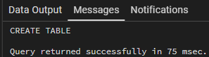

### 1.2. Додавання початкових даних (`INSERT`)

Виконано наповнення довідників авторів, книг та читачів із дотриманням усіх обмежень унікальності та зовнішніх ключів.

~~~sql
INSERT INTO authors (first_name, last_name, birth_year, country) VALUES
    ('Тарас', 'Шевченко', 1814, 'Україна'),
    ('Іван', 'Франко', 1856, 'Україна'),
    ('Леся', 'Українка', 1871, 'Україна'),
    ('Михайло', 'Коцюбинський', 1864, 'Україна'),
    ('Панас', 'Мирний', 1849, 'Україна');

INSERT INTO books (isbn, title, author_id, publication_year, genre, total_copies, available_copies) VALUES
    ('978-966-03-4561-2', 'Кобзар', 1, 1840, 'Поезія', 10, 8),
    ('978-966-03-4562-9', 'Захар Беркут', 2, 1883, 'Історична проза', 5, 4),
    ('978-966-03-4563-6', 'Лісова пісня', 3, 1911, 'Драма', 7, 7),
    ('978-966-03-4564-3', 'Тіні забутих предків', 4, 1911, 'Повість', 6, 5),
    ('978-966-03-4565-0', 'Хіба ревуть воли, як ясла повні', 5, 1880, 'Повість', 4, 4);

INSERT INTO readers (first_name, last_name, email, phone, library_card_number, status) VALUES
    ('Олена', 'Петренко', 'olena.petrenko@email.com', '+380501234567', 'LIB-2024-001', 'Active'),
    ('Андрій', 'Коваленко', 'andrii.kovalenko@email.com', '+380502345678', 'LIB-2024-002', 'Active'),
    ('Марія', 'Сидоренко', 'maria.sydorenko@email.com', '+380503456789', 'LIB-2024-003', 'Active'),
    ('Іван', 'Мельник', 'ivan.melnyk@email.com', '+380504567890', 'LIB-2024-004', 'Inactive');

SELECT * FROM books;
~~~

* **Результат:** Додано 5 авторів, 5 книг та 4 читачів; на скріншоті підтверджено коректне заповнення таблиці `books`.
* **Скріншот:**

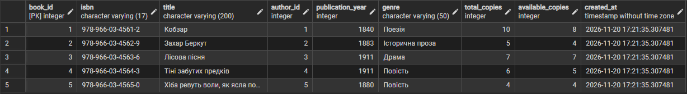

### 1.3. Безпечне оновлення записів (`UPDATE` + `RETURNING`)

Перед зміною даних виконано перевірку цільового запису через `SELECT`, після чого оновлено кількість доступних примірників із обов'язковою умовою `WHERE` та поверненням зміненого рядка через `RETURNING`.

~~~sql
SELECT book_id, title, total_copies, available_copies
FROM books
WHERE book_id = 1;

UPDATE books
SET available_copies = available_copies - 1
WHERE book_id = 1 AND available_copies > 0
RETURNING book_id, title, total_copies, available_copies;
~~~

* **Результат:** Кількість доступних примірників книги «Кобзар» (`book_id = 1`) безпечно зменшено з `8` до `7`.
* **Скріншот:**

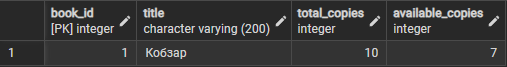

### 1.4. Групування операцій у транзакцію (`BEGIN ... COMMIT`)

Оформлення видачі книги читачу реалізовано як атомарну транзакцію: створення запису в `lendings` та зменшення доступного залишку в `books` фіксуються одночасно командою `COMMIT`.

~~~sql
BEGIN;

INSERT INTO lendings (book_id, reader_id, due_date)
VALUES (1, 1, CURRENT_DATE + INTERVAL '14 days');

UPDATE books
SET available_copies = available_copies - 1
WHERE book_id = 1 AND available_copies > 0;

COMMIT;

SELECT l.lending_id, b.title, r.first_name || ' ' || r.last_name AS reader, l.due_date, b.available_copies
FROM lendings l
JOIN books b ON l.book_id = b.book_id
JOIN readers r ON l.reader_id = r.reader_id;
~~~

* **Результат:** Зафіксовано нову видачу (`lending_id = 1`) для читачки Олени Петренко, а кількість доступних примірників зменшилась до `6`.
* **Скріншот:**

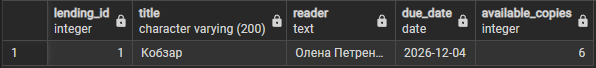

### 1.5. Демонстрація відкату транзакції при помилках (`ROLLBACK`)

Продемонстровано захист посилальної цілісності (`ON DELETE RESTRICT`) при спробі видалити автора, за яким закріплені книги, та повне скасування змін командою `ROLLBACK`.

~~~sql
BEGIN;
DELETE FROM authors WHERE author_id = 1;
-- Виникає помилка порушення обмеження зовнішнього ключа
ROLLBACK;

SELECT * FROM authors WHERE author_id = 1;
~~~

* **Результат:** СУБД заблокувала видалення та перевела транзакцію у перерваний стан; після виконання `ROLLBACK` запис автора (Тарас Шевченко) залишився незмінним.
* **Скріншоти:**

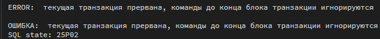

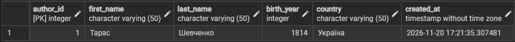

### 1.6. Безпечне видалення записів (`DELETE`)

Виконано попередню вибірку та подальше видалення неактивного читача, який не має неповернутих книг у таблиці `lendings`.

~~~sql
SELECT * FROM readers
WHERE status = 'Inactive'
  AND reader_id NOT IN (
      SELECT DISTINCT reader_id FROM lendings WHERE return_date IS NULL
  );

DELETE FROM readers
WHERE status = 'Inactive'
  AND reader_id NOT IN (
      SELECT DISTINCT reader_id FROM lendings WHERE return_date IS NULL
  )
RETURNING reader_id, first_name, last_name, status;
~~~

* **Результат:** Безпечно видалено лише одного неактивного читача без боргів (Іван Мельник, `reader_id = 4`).
* **Скріншот:**

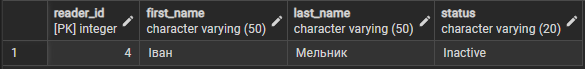

---

## 2. Рівень 2. Розширені транзакції, тригери та блокування

### 2.1. Створення таблиць бронювань та журналу аудиту

Додано таблицю `reservations` із каскадним видаленням (`ON DELETE CASCADE`) та таблицю `audit_log` для зберігання історії змін у форматі `JSONB`.

~~~sql
CREATE TABLE reservations (
    reservation_id SERIAL PRIMARY KEY,
    book_id INTEGER NOT NULL,
    reader_id INTEGER NOT NULL,
    reservation_date TIMESTAMP DEFAULT CURRENT_TIMESTAMP,
    expiration_date TIMESTAMP NOT NULL,
    status VARCHAR(20) DEFAULT 'Active' CHECK (status IN ('Active', 'Fulfilled', 'Cancelled', 'Expired')),
    FOREIGN KEY (book_id) REFERENCES books(book_id) ON DELETE CASCADE,
    FOREIGN KEY (reader_id) REFERENCES readers(reader_id) ON DELETE CASCADE
);

CREATE TABLE audit_log (
    log_id SERIAL PRIMARY KEY,
    table_name VARCHAR(50) NOT NULL,
    operation VARCHAR(10) NOT NULL,
    record_id INTEGER NOT NULL,
    old_data JSONB,
    new_data JSONB,
    changed_at TIMESTAMP DEFAULT CURRENT_TIMESTAMP,
    changed_by VARCHAR(100) DEFAULT CURRENT_USER
);
~~~

* **Результат:** Таблиці `reservations` та `audit_log` успішно розгорнуто.
* **Скріншот:**

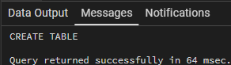

### 2.2. Складна транзакція повернення книги та виконання бронювання

Реалізовано комплексну транзакцію, яка одночасно закриває видачу книги (`return_date`), повертає примірник на баланс у `books` та автоматично переводить перше активне бронювання цієї книги у статус `Fulfilled`.

~~~sql
INSERT INTO reservations (book_id, reader_id, expiration_date)
VALUES (1, 2, CURRENT_TIMESTAMP + INTERVAL '3 days');

BEGIN;

UPDATE lendings
SET return_date = CURRENT_DATE
WHERE lending_id = 1 AND return_date IS NULL;

UPDATE books
SET available_copies = available_copies + 1
WHERE book_id = (SELECT book_id FROM lendings WHERE lending_id = 1);

UPDATE reservations
SET status = 'Fulfilled'
WHERE reservation_id = (
    SELECT reservation_id
    FROM reservations
    WHERE book_id = (SELECT book_id FROM lendings WHERE lending_id = 1)
      AND status = 'Active'
    ORDER BY reservation_date
    LIMIT 1
);

COMMIT;

SELECT r.reservation_id, b.title, rd.first_name || ' ' || rd.last_name AS reader, r.status, b.available_copies
FROM reservations r
JOIN books b ON r.book_id = b.book_id
JOIN readers rd ON r.reader_id = rd.reader_id;
~~~

* **Результат:** Усі три таблиці узгоджено оновилися в межах однієї транзакції: бронювання отримало статус `Fulfilled`, а залишок примірників зріс до `7`.
* **Скріншот:**

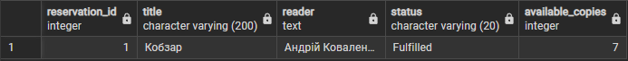

### 2.3. Частковий відкат транзакції за допомогою `SAVEPOINT`

Продемонстровано гнучке керування транзакцією: після додавання авторки Ольги Кобилянської створено точку збереження `after_author`, спровоковано помилку дубліката `ISBN`, виконано частковий відкат до точки збереження (`ROLLBACK TO SAVEPOINT`) та успішно вставлено книгу з коректним `ISBN`.

~~~sql
BEGIN;

INSERT INTO authors (first_name, last_name, birth_year, country)
VALUES ('Ольга', 'Кобилянська', 1863, 'Україна');

SAVEPOINT after_author;

-- Спроба вставки дубліката ISBN викликає помилку унікальності
INSERT INTO books (isbn, title, author_id, publication_year, genre, total_copies, available_copies)
VALUES ('978-966-03-4561-2', 'Земля', CURRVAL('authors_author_id_seq'), 1902, 'Роман', 3, 3);

ROLLBACK TO SAVEPOINT after_author;

INSERT INTO books (isbn, title, author_id, publication_year, genre, total_copies, available_copies)
VALUES ('978-966-03-4567-4', 'Земля', CURRVAL('authors_author_id_seq'), 1902, 'Роман', 3, 3);

COMMIT;

SELECT b.book_id, b.isbn, b.title, a.first_name || ' ' || a.last_name AS author
FROM books b
JOIN authors a ON b.author_id = a.author_id
WHERE a.last_name = 'Кобилянська';
~~~

* **Результат:** Попри помилку вставки дубліката ISBN, додавання авторки не було втрачено, а книга «Земля» успішно збереглася після відкату до `SAVEPOINT`.
* **Скріншоти:**

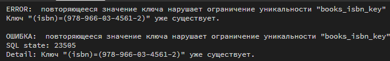

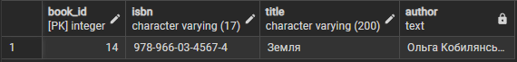

### 2.4. Каскадні операції (`ON DELETE CASCADE`)

Перевірено роботу каскадного видалення: при видаленні тестової книги з таблиці `books` її залежне бронювання в таблиці `reservations` видалилося автоматично.

~~~sql
BEGIN;
INSERT INTO authors (first_name, last_name, birth_year, country)
VALUES ('Тестовий', 'Автор', 1900, 'Україна');

INSERT INTO books (isbn, title, author_id, publication_year, genre, total_copies, available_copies)
VALUES ('978-966-00-0000-0', 'Тестова книга', CURRVAL('authors_author_id_seq'), 2000, 'Тест', 1, 0);

INSERT INTO reservations (book_id, reader_id, expiration_date)
VALUES (CURRVAL('books_book_id_seq'), 1, CURRENT_TIMESTAMP + INTERVAL '7 days');
COMMIT;

DELETE FROM books WHERE isbn = '978-966-00-0000-0';

SELECT * FROM reservations WHERE book_id NOT IN (SELECT book_id FROM books);
~~~

* **Результат:** Запит перевірки повернув `0` рядків — залежне бронювання видалено каскадно без порушення цілісності.
* **Скріншот:**

### 2.5. Тригери для автоматичного ведення історії змін

Створено тригерну функцію `log_books_changes()` та тригер `books_audit_trigger`, який автоматично фіксує старий (`old_data`) і новий (`new_data`) стан рядків у таблиці `audit_log` при кожній операції `INSERT`, `UPDATE` чи `DELETE`.

~~~sql
CREATE OR REPLACE FUNCTION log_books_changes()
RETURNS TRIGGER AS $$
BEGIN
    IF TG_OP = 'INSERT' THEN
        INSERT INTO audit_log (table_name, operation, record_id, new_data)
        VALUES ('books', 'INSERT', NEW.book_id, row_to_json(NEW)::jsonb);
    ELSIF TG_OP = 'UPDATE' THEN
        INSERT INTO audit_log (table_name, operation, record_id, old_data, new_data)
        VALUES ('books', 'UPDATE', NEW.book_id, row_to_json(OLD)::jsonb, row_to_json(NEW)::jsonb);
    ELSIF TG_OP = 'DELETE' THEN
        INSERT INTO audit_log (table_name, operation, record_id, old_data)
        VALUES ('books', 'DELETE', OLD.book_id, row_to_json(OLD)::jsonb);
    END IF;
    RETURN NULL;
END;
$$ LANGUAGE plpgsql;

CREATE TRIGGER books_audit_trigger
AFTER INSERT OR UPDATE OR DELETE ON books
FOR EACH ROW
EXECUTE FUNCTION log_books_changes();

UPDATE books SET available_copies = available_copies + 1 WHERE book_id = 1;

SELECT log_id, operation, record_id,
       new_data->>'title' AS title,
       old_data->>'available_copies' AS old_copies,
       new_data->>'available_copies' AS new_copies,
       changed_at
FROM audit_log
WHERE table_name = 'books'
ORDER BY changed_at DESC;
~~~

* **Результат:** Тригер автоматично зафіксував операцію `UPDATE` для книги «Кобзар» зі зміною залишку з `7` на `8`.
* **Скріншот:**

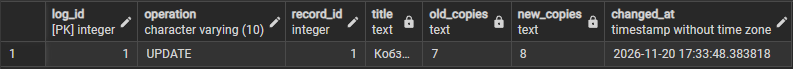

### 2.6. Механізм блокування записів при паралельному доступі (`FOR UPDATE`)

У двох паралельних сесіях pgAdmin продемонстровано песимістичне блокування рядка (`SELECT ... FOR UPDATE`): друга транзакція автоматично очікувала звільнення блокування першою транзакцією (`5 secs 222 msec`) і виконала оновлення лише після її фіксації (`COMMIT`).

~~~sql
-- Сесія 1 та Сесія 2 (паралельно):
BEGIN;
SELECT book_id, title, available_copies FROM books WHERE book_id = 1 FOR UPDATE;
UPDATE books SET available_copies = available_copies - 1 WHERE book_id = 1;
COMMIT;
~~~

* **Результат:** Аномалію втраченого оновлення (Lost Update) успішно попереджено за рахунок блокування рядка на рівні СУБД.
* **Скріншот:**

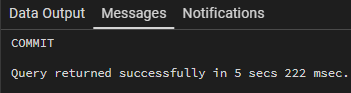

---

## 3. Рівень 3. Версіонування, бізнес-логіка, безпека та відновлення

### 3.1. Система версіонування записів

Реалізовано таблицю `books_versions`, тригер `book_versioning_trigger` для збереження всіх історичних версій книг із часовими інтервалами актуальності (`valid_from`, `valid_to`) та функцію `get_book_version()` для отримання стану запису на конкретну дату.

~~~sql
CREATE TABLE books_versions (
    version_id SERIAL PRIMARY KEY,
    book_id INTEGER NOT NULL,
    version_number INTEGER NOT NULL,
    data JSONB NOT NULL,
    valid_from TIMESTAMP DEFAULT CURRENT_TIMESTAMP,
    valid_to TIMESTAMP,
    created_by VARCHAR(100) DEFAULT CURRENT_USER,
    UNIQUE(book_id, version_number)
);

CREATE OR REPLACE FUNCTION create_book_version()
RETURNS TRIGGER AS $$
DECLARE
    v_version_number INTEGER;
BEGIN
    UPDATE books_versions
    SET valid_to = CURRENT_TIMESTAMP
    WHERE book_id = NEW.book_id AND valid_to IS NULL;

    SELECT COALESCE(MAX(version_number), 0) + 1
    INTO v_version_number
    FROM books_versions
    WHERE book_id = NEW.book_id;

    INSERT INTO books_versions (book_id, version_number, data)
    VALUES (NEW.book_id, v_version_number, row_to_json(NEW)::jsonb);

    RETURN NEW;
END;
$$ LANGUAGE plpgsql;

CREATE TRIGGER book_versioning_trigger
AFTER INSERT OR UPDATE ON books
FOR EACH ROW
EXECUTE FUNCTION create_book_version();

UPDATE books SET available_copies = available_copies + 1 WHERE book_id = 1;
UPDATE books SET genre = 'Класична поезія' WHERE book_id = 1;

SELECT version_id, book_id, version_number, data->>'genre' AS genre, data->>'available_copies' AS copies, valid_from, valid_to
FROM books_versions
WHERE book_id = 1
ORDER BY version_number;
~~~

* **Результат:** У таблиці `books_versions` зафіксовано послідовні версії запису: попередня версія (`№1`) автоматично закрита міткою `valid_to`, а актуальна (`№2`) має `valid_to = NULL`.
* **Скріншот:**

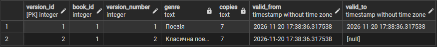

### 3.2. Механізм відкладених операцій

Створено чергу запланованих завдань `scheduled_operations` та обробник `execute_scheduled_operations()`, який автоматично виконує відкладені операції (`EXPIRE_RESERVATION`, `UPDATE_BOOK_STATUS`, `BLOCK_READER`), коли настає час `scheduled_for`.

~~~sql
CREATE TABLE scheduled_operations (
    operation_id SERIAL PRIMARY KEY,
    operation_type VARCHAR(50) NOT NULL,
    target_table VARCHAR(50) NOT NULL,
    operation_data JSONB NOT NULL,
    scheduled_for TIMESTAMP NOT NULL,
    status VARCHAR(20) DEFAULT 'Pending' CHECK (status IN ('Pending', 'Executed', 'Failed', 'Cancelled')),
    executed_at TIMESTAMP,
    error_message TEXT,
    created_at TIMESTAMP DEFAULT CURRENT_TIMESTAMP
);

CREATE OR REPLACE FUNCTION execute_scheduled_operations()
RETURNS INTEGER AS $$
DECLARE
    v_operation RECORD;
    v_count INTEGER := 0;
BEGIN
    FOR v_operation IN
        SELECT * FROM scheduled_operations
        WHERE status = 'Pending' AND scheduled_for <= CURRENT_TIMESTAMP
    LOOP
        BEGIN
            CASE v_operation.operation_type
                WHEN 'UPDATE_BOOK_STATUS' THEN
                    UPDATE books
                    SET available_copies = (v_operation.operation_data->>'available_copies')::INTEGER
                    WHERE book_id = (v_operation.operation_data->>'book_id')::INTEGER;
                WHEN 'EXPIRE_RESERVATION' THEN
                    UPDATE reservations
                    SET status = 'Expired'
                    WHERE reservation_id = (v_operation.operation_data->>'reservation_id')::INTEGER;
                WHEN 'BLOCK_READER' THEN
                    UPDATE readers
                    SET status = 'Blocked'
                    WHERE reader_id = (v_operation.operation_data->>'reader_id')::INTEGER;
            END CASE;

            UPDATE scheduled_operations
            SET status = 'Executed', executed_at = CURRENT_TIMESTAMP
            WHERE operation_id = v_operation.operation_id;

            v_count := v_count + 1;
        EXCEPTION WHEN OTHERS THEN
            UPDATE scheduled_operations
            SET status = 'Failed', executed_at = CURRENT_TIMESTAMP, error_message = SQLERRM
            WHERE operation_id = v_operation.operation_id;
        END;
    END LOOP;

    RETURN v_count;
END;
$$ LANGUAGE plpgsql;

SELECT execute_scheduled_operations() AS executed_tasks;
SELECT operation_id, operation_type, status, executed_at FROM scheduled_operations;
~~~

* **Результат:** Відкладена операція скасування простроченого бронювання успішно виконана та переведена у статус `Executed`.
* **Скріншот:**

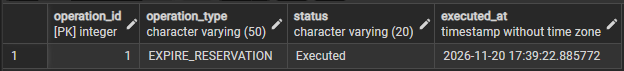

### 3.3. Збережена функція складної бізнес-логіки (`extend_lending`)

Розроблено функцію `extend_lending()`, яка перед продовженням терміну користування книгою перевіряє статус читача (чи не заблокований він) та відсутність прострочених неповернутих книг.

~~~sql
CREATE OR REPLACE FUNCTION extend_lending(
    p_lending_id INTEGER,
    p_days INTEGER DEFAULT 7
)
RETURNS TABLE (
    success BOOLEAN,
    message TEXT,
    new_due_date DATE
) AS $$
DECLARE
    v_reader_status VARCHAR(20);
    v_overdue_count INTEGER;
    v_current_due_date DATE;
BEGIN
    SELECT r.status, l.due_date
    INTO v_reader_status, v_current_due_date
    FROM lendings l
    JOIN readers r ON l.reader_id = r.reader_id
    WHERE l.lending_id = p_lending_id;

    IF v_reader_status = 'Blocked' THEN
        RETURN QUERY SELECT FALSE, 'Читач заблокований'::TEXT, NULL::DATE;
        RETURN;
    END IF;

    SELECT COUNT(*)
    INTO v_overdue_count
    FROM lendings l
    WHERE l.reader_id = (SELECT reader_id FROM lendings WHERE lending_id = p_lending_id)
      AND l.return_date IS NULL
      AND l.due_date < CURRENT_DATE;

    IF v_overdue_count > 0 THEN
        RETURN QUERY SELECT FALSE, 'У читача є прострочені книги'::TEXT, NULL::DATE;
        RETURN;
    END IF;

    UPDATE lendings
    SET due_date = due_date + p_days
    WHERE lending_id = p_lending_id;

    RETURN QUERY SELECT TRUE, 'Термін успішно продовжено'::TEXT, (v_current_due_date + p_days)::DATE;
END;
$$ LANGUAGE plpgsql;

SELECT * FROM extend_lending(CURRVAL('lendings_lending_id_seq')::INTEGER, 14);
~~~

* **Результат:** Бізнес-перевірки пройдено успішно, термін повернення книги продовжено на 14 днів (`success = true`).
* **Скріншот:**

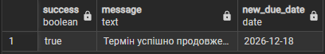

### 3.4. Система ролей та розмежування прав доступу

Створено ролі `librarian_read` (лише читання), `librarian_write` (модифікація оперативних таблиць без права видалення довідників) та `library_admin` (повні права). Перевірено блокування операції `UPDATE` при роботі під роллю `librarian_read`.

~~~sql
CREATE ROLE librarian_read;
CREATE ROLE librarian_write;
CREATE ROLE library_admin;

GRANT SELECT ON ALL TABLES IN SCHEMA public TO librarian_read;
GRANT SELECT, INSERT, UPDATE ON books, lendings, reservations TO librarian_write;
GRANT DELETE ON reservations TO librarian_write;
GRANT USAGE, SELECT ON ALL SEQUENCES IN SCHEMA public TO librarian_write;
GRANT ALL PRIVILEGES ON ALL TABLES IN SCHEMA public TO library_admin;
GRANT ALL PRIVILEGES ON ALL SEQUENCES IN SCHEMA public TO library_admin;

SET ROLE librarian_read;
UPDATE books SET available_copies = 5 WHERE book_id = 1;
-- Помилка прав доступу: permission denied for table books
RESET ROLE;
~~~

* **Результат:** Спроба змінити дані під роллю `librarian_read` заблокована системою безпеки PostgreSQL (`SQL state: 42501`).
* **Скріншот:**

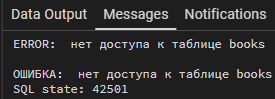

### 3.5. Резервне копіювання та відновлення (`backup_points`)

Реалізовано механізм створення контрольних точок (`create_backup_point`) зі збереженням знімків усіх основних таблиць у форматі `JSONB` та функцію відновлення (`restore_from_backup`).

~~~sql
CREATE TABLE backup_points (
    backup_id SERIAL PRIMARY KEY,
    backup_name VARCHAR(100) NOT NULL,
    backup_timestamp TIMESTAMP DEFAULT CURRENT_TIMESTAMP,
    description TEXT,
    data_snapshot JSONB
);

CREATE OR REPLACE FUNCTION create_backup_point(p_name VARCHAR, p_description TEXT DEFAULT NULL)
RETURNS INTEGER AS $$
DECLARE
    v_backup_id INTEGER;
    v_snapshot JSONB;
BEGIN
    SELECT jsonb_build_object(
        'books', (SELECT jsonb_agg(row_to_json(b)) FROM books b),
        'authors', (SELECT jsonb_agg(row_to_json(a)) FROM authors a),
        'readers', (SELECT jsonb_agg(row_to_json(r)) FROM readers r),
        'lendings', (SELECT jsonb_agg(row_to_json(l)) FROM lendings l)
    ) INTO v_snapshot;

    INSERT INTO backup_points (backup_name, description, data_snapshot)
    VALUES (p_name, p_description, v_snapshot)
    RETURNING backup_id INTO v_backup_id;

    RETURN v_backup_id;
END;
$$ LANGUAGE plpgsql;

SELECT create_backup_point('Before major update', 'Повна резервна копія стану бібліотеки') AS created_backup_id;
SELECT backup_id, backup_name, backup_timestamp, description FROM backup_points;
~~~

* **Результат:** Створено контрольну точку `backup_id = 1` із повним JSONB-знімком стану бази даних.
* **Скріншот:**

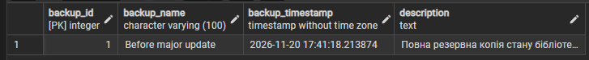

### 3.6. Інтерфейс перегляду історії змін (`VIEW` та звіти за період)

Створено представлення `books_change_history` для формування зрозумілого текстового опису всіх змін над книгами з журналу `audit_log` та функцію агрегованої статистики `get_changes_report()`.

~~~sql
CREATE OR REPLACE VIEW books_change_history AS
SELECT
    a.log_id,
    a.operation,
    a.record_id AS book_id,
    COALESCE(a.new_data->>'title', a.old_data->>'title') AS title,
    CASE
        WHEN a.operation = 'INSERT' THEN 'Додано нову книгу'
        WHEN a.operation = 'UPDATE' THEN
            'Оновлено: ' ||
            CASE
                WHEN a.old_data->>'available_copies' <> a.new_data->>'available_copies'
                THEN 'Доступні примірники: ' || (a.old_data->>'available_copies') || ' -> ' || (a.new_data->>'available_copies')
                WHEN a.old_data->>'genre' <> a.new_data->>'genre'
                THEN 'Жанр: ' || (a.old_data->>'genre') || ' -> ' || (a.new_data->>'genre')
                ELSE 'Інші поля'
            END
        WHEN a.operation = 'DELETE' THEN 'Видалено книгу'
    END AS change_description,
    a.changed_at,
    a.changed_by
FROM audit_log a
WHERE a.table_name = 'books'
ORDER BY a.changed_at DESC;

SELECT * FROM books_change_history;
~~~

* **Результат:** Представлення наочно відображає хронологію всіх змін книги «Кобзар» (зміну кількості доступних примірників та жанру) із зазначенням користувача та часу.
* **Скріншот:**

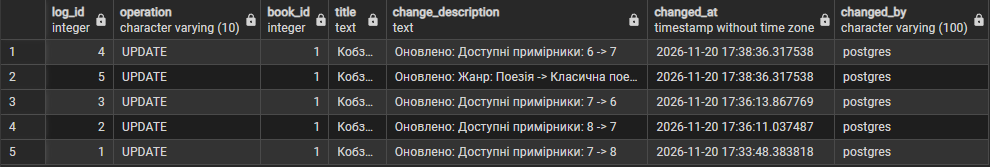

---

## 4. Відповіді на контрольні запитання

1. **У чому полягає різниця між операторами `INSERT`, `UPDATE` та `DELETE`? Які обмеження необхідно враховувати при їх використанні?**
   * `INSERT` додає нові рядки до таблиці (враховуються обмеження `PRIMARY KEY`, `NOT NULL`, `UNIQUE`, `CHECK` та наявність батьківських ключів для `FOREIGN KEY`).
   * `UPDATE` змінює значення полів у вже існуючих рядках (перевіряються `CHECK`, `UNIQUE`, `NOT NULL` та каскадні правила при зміні ключів).
   * `DELETE` видаляє рядки з таблиці (обов'язково враховуються правила посилальної цілісності `FOREIGN KEY`: `RESTRICT`, `CASCADE`, `SET NULL`, `SET DEFAULT`).

2. **Чому використання умови `WHERE` є критично важливим в операціях `UPDATE` та `DELETE`? Які наслідки можуть бути від її пропуску?**
   * Без секції `WHERE` оператори `UPDATE` та `DELETE` застосовуються до **абсолютно всіх рядків таблиці**. Пропуск `WHERE` призведе до масового перезапису даних однаковими значеннями або повного знищення вмісту всієї таблиці.

3. **Що таке транзакція та які властивості ACID вона забезпечує? Поясніть кожну властивість на конкретному прикладі.**
   * Транзакція — це неподільна логічна послідовність операцій над БД:
     * **Atomicity (Атомарність):** «все або нічого» — при видачі книги запис у `lendings` і зменшення `available_copies` у `books` або виконуються обидва, або при збої скасовуються обидва.
     * **Consistency (Узгодженість):** транзакція переводить БД з одного коректного стану в інший без порушення правил (наприклад, `available_copies` ніколи не стане від'ємним).
     * **Isolation (Ізольованість):** дві одночасні видачі останнього примірника книги не заважають одна одній завдяки блокуванням, наче виконуються послідовно.
     * **Durability (Довговічність):** після виконання `COMMIT` інформація про видачу книги збережеться на диску навіть у разі раптового вимкнення живлення.

4. **Яка різниця між командами `COMMIT` та `ROLLBACK`? У яких ситуаціях використовується кожна з них?**
   * `COMMIT` остаточно підтверджує і фіксує всі зміни, виконані в межах поточної транзакції (використовується при успішному завершенні всіх кроків).
   * `ROLLBACK` повністю скасовує всі незафіксовані зміни поточної транзакції та повертає базу в початковий стан (використовується при виникненні помилок або порушенні бізнес-правил).

5. **Що таке точки збереження `SAVEPOINT` і як вони дозволяють керувати транзакціями більш гнучко порівняно з простим `ROLLBACK`?**
   * `SAVEPOINT` створює проміжну мітку всередині великої транзакції. На відміну від звичайного `ROLLBACK`, який скасовує всю транзакцію цілком, команда `ROLLBACK TO SAVEPOINT` дозволяє відкотити лише невдалу частину операцій після мітки, зберігши попередню виконану роботу (наприклад, зберегти доданого автора при помилці вставки книги).

6. **Які типи обмежень цілісності ви знаєте? Як кожен з них допомагає підтримувати коректність даних у базі?**
   * `PRIMARY KEY` — унікально ідентифікує кожен запис і забороняє `NULL`.
   * `FOREIGN KEY` — гарантує посилальну цілісність між таблицями (не дає прив'язати книгу до неіснуючого автора).
   * `UNIQUE` — запобігає дублюванню значень (наприклад, однакових `ISBN` або `email`).
   * `CHECK` — перевіряє виконання логічної умови (наприклад, `available_copies >= 0`).
   * `NOT NULL` — гарантує обов'язкову заповненість критичних полів.

7. **Що таке каскадні операції та які варіанти їх поведінки існують при видаленні або оновленні батьківських записів?**
   * Це автоматичні дії СУБД над дочірніми записами при зміні батьківського ключа:
     * `RESTRICT` / `NO ACTION` — забороняє видалення/оновлення батьківського запису за наявності дочірніх;
     * `CASCADE` — автоматично видаляє або оновлює всі пов'язані дочірні записи;
     * `SET NULL` — встановлює `NULL` у зовнішньому ключі дочірніх записів;
     * `SET DEFAULT` — підставляє значення за замовчуванням у зовнішній ключ.

8. **Яку роль відіграють тригери в забезпеченні цілісності даних та автоматизації операцій? Наведіть приклади їх практичного застосування.**
   * Тригери автоматично виконують задану функцію при настанні подій `INSERT`, `UPDATE` або `DELETE` незалежно від того, який клієнт чи застосунок змінює дані. Приклади: ведення журналу аудиту (`audit_log`), збереження історії версій записів (`books_versions`), складні перевірки цілісності між різними таблицями.

9. **Чому необхідно використовувати блокування записів при паралельному доступі? Які проблеми можуть виникнути без них?**
   * Блокування (`FOR UPDATE`) синхронізують одночасний доступ кількох користувачів до одних і тих самих рядків. Без них виникають аномалії паралельності: **втрачене оновлення** (Lost Update, коли два бібліотекарі одночасно списують останній примірник книги), **брудне читання** та **неповторюване читання**.

10. **Як рівні ізоляції транзакцій впливають на можливі аномалії при паралельному виконанні операцій? Який рівень слід обирати для різних сценаріїв?**
    * `READ UNCOMMITTED` — допускає брудне читання (у PostgreSQL поводиться як `READ COMMITTED`).
    * `READ COMMITTED` (за замовчуванням у PostgreSQL) — захищає від брудного читання, оптимальний для більшості звичайних транзакцій.
    * `REPEATABLE READ` — гарантує незмінність прочитаних рядків протягом усієї транзакції (захищає від неповторюваного читання та фантомів у PostgreSQL), підходить для формування узгоджених фінансових та аналітичних звітів.
    * `SERIALIZABLE` — забезпечує повну ізоляцію, еквівалентну послідовному виконанню, обирається для критичних фінансових операцій із високим ризиком конфліктів.

---

## 5. Висновки

* **Самооцінка:** 5 (Відмінно).
* **Обґрунтування:** Повністю реалізовано всі завдання 1-го, 2-го та 3-го рівнів складності на локальному сервері PostgreSQL 17. Спроєктовано структуру бази даних бібліотеки з обмеженнями цілісності, відпрацьовано безпечні операції модифікації (`INSERT`, `UPDATE`, `DELETE`), прості та складні транзакції з `COMMIT`, `ROLLBACK` і `SAVEPOINT`, каскадні операції та песимістичні блокування `FOR UPDATE`. Впроваджено тригерний аудит та версіонування записів, чергу відкладених операцій, бізнес-процедуру продовження видачі, систему ролей доступу, резервне копіювання у форматі `JSONB` та представлення історії змін.